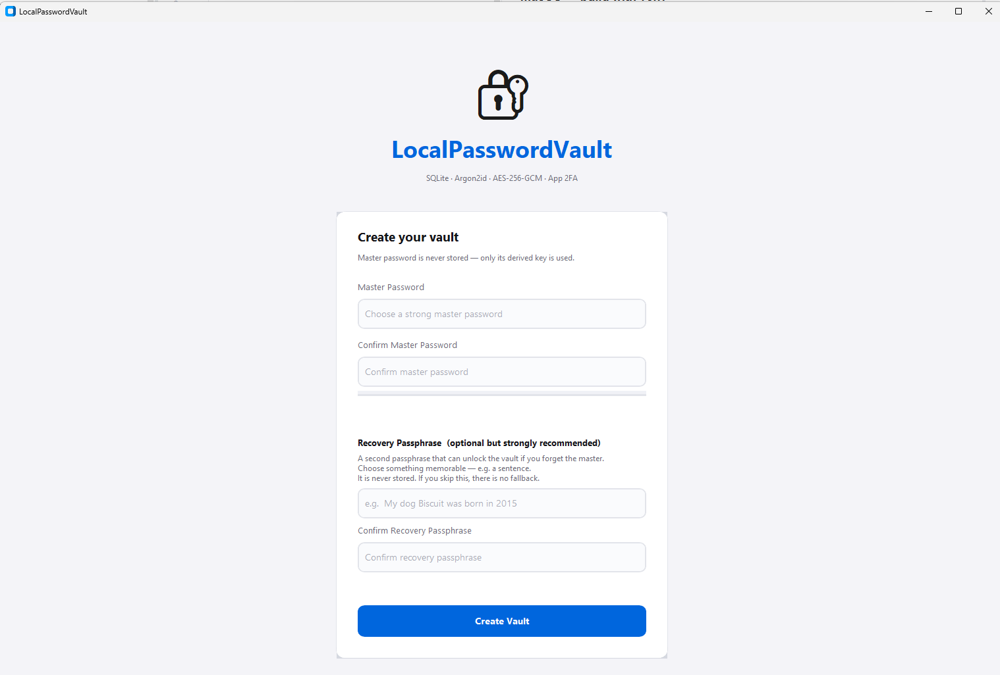
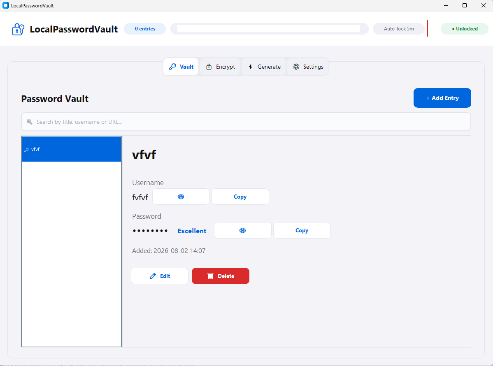
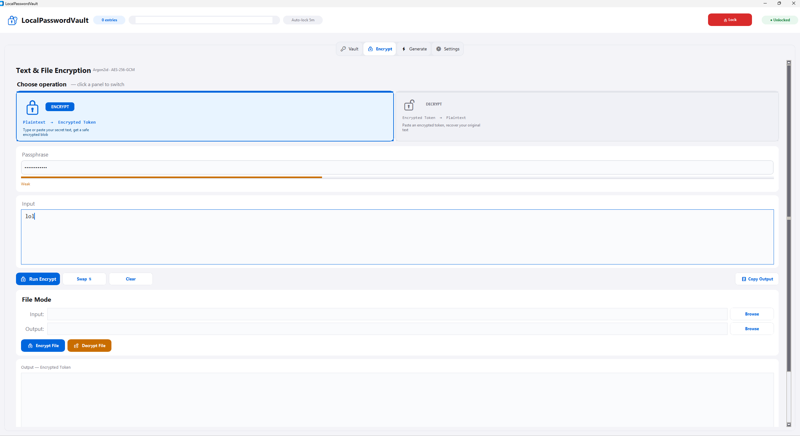
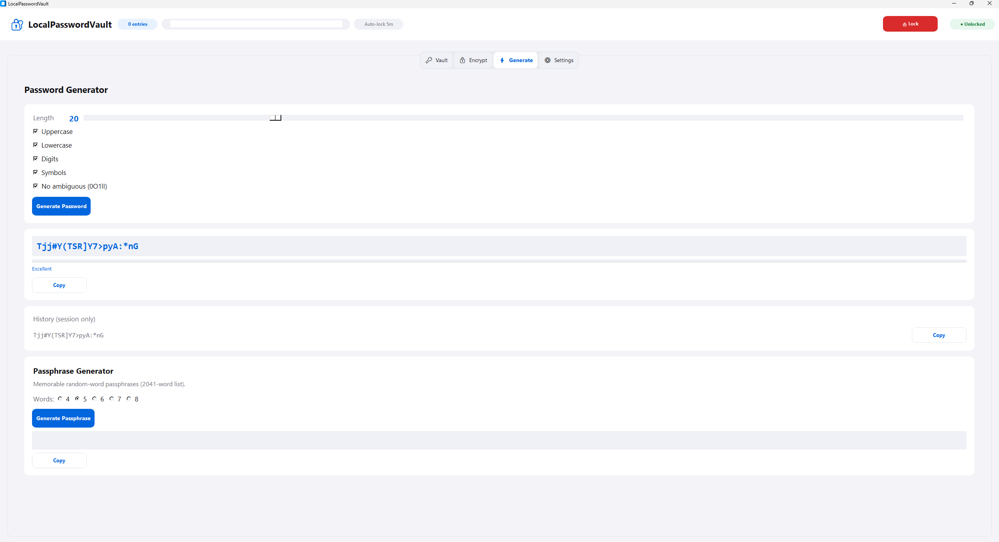
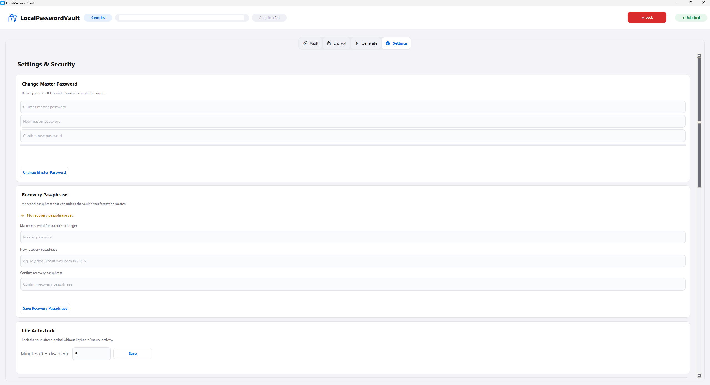
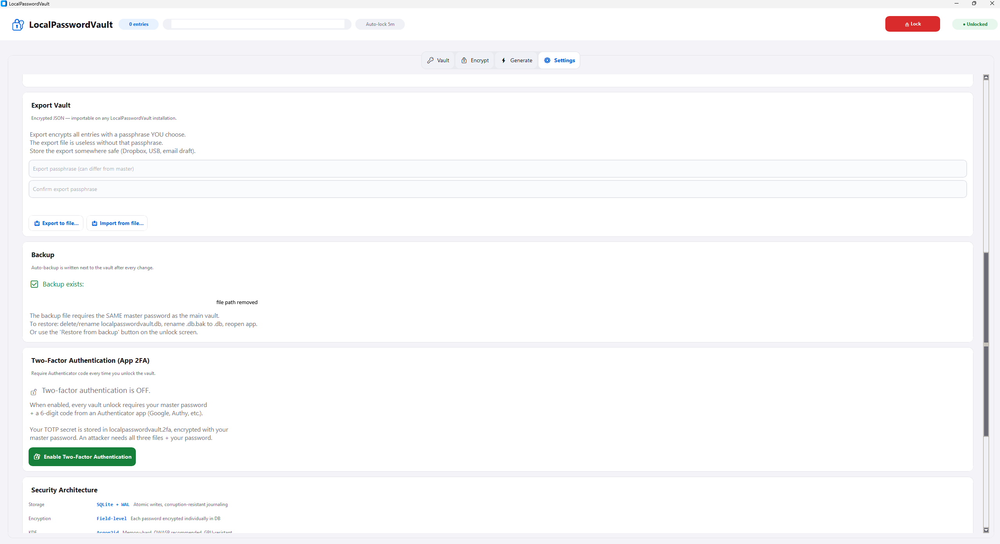
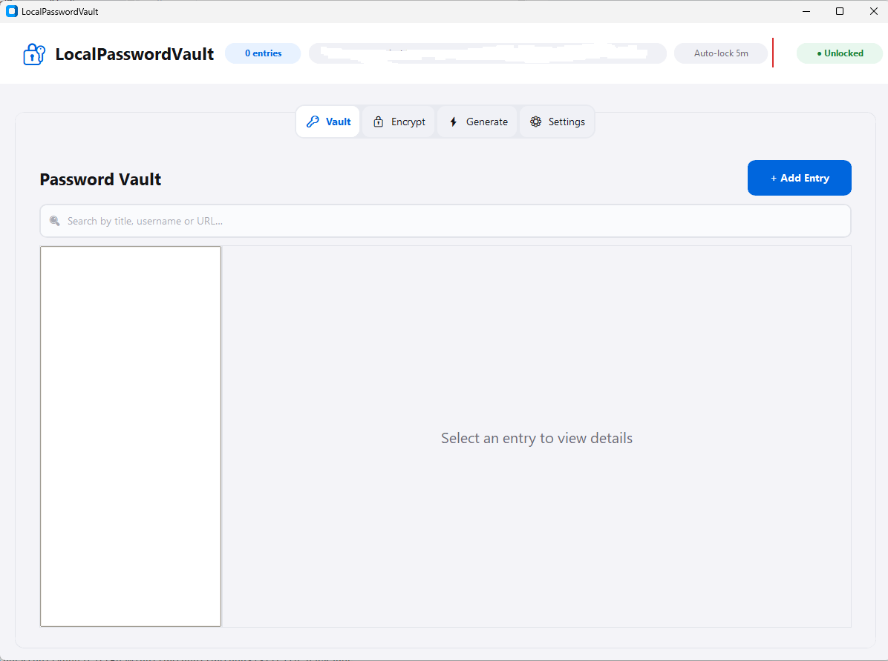

# LocalPasswordVault

Desktop password manager and encryption tool for **Windows** and **macOS**.

- **Storage:** SQLite (`localpasswordvault.db`) with field-level encryption  
- **Crypto:** Argon2id + AES-256-GCM (random DEK wrapped by master / recovery)  
- **2FA:** App-level TOTP (`localpasswordvault.2fa`) + recovery codes  
- **UI:** PySide6 Qt Quick (Vault · Encrypt · Generate · Settings). `python app.py` opens Qt. The previous CustomTkinter window is `python tk_app.py`.

Requires **Python 3.11+**. Licensed under the [MIT License](LICENSE).

### Screenshots

These images are the previous CustomTkinter window. The running app is the Qt Quick UI.



| Vault | Encrypt |
|:-----:|:-------:|
|  |  |

| Generate | Settings |
|:--------:|:--------:|
|  |  |

| Export / 2FA | Empty vault |
|:------------:|:-----------:|
|  |  |

---

## Disclaimer — use AS IS

**LocalPasswordVault is provided AS IS, without warranty of any kind**, express or implied, including but not limited to merchantability, fitness for a particular purpose, and non-infringement. The authors are **not liable** for any data loss, security breach, or damages arising from use of this software.

- This is a **personal / experimental** tool, not a substitute for an audited commercial password manager.
- **You** are responsible for strong master passwords, recovery passphrase custody, backups, and your threat model.
- Titles, usernames, URLs, notes, passwords, and TOTP secrets are field-encrypted. The master password and data key still exist in process memory while the vault is unlocked.
- There is **no formal security audit**. Run tests (`pytest`) before relying on a build; keep encrypted exports.
- By using this software you accept these terms. See also [LICENSE](LICENSE) and [architecture.md](architecture.md).

---

## Quick start (clone from Git)

```bash
git clone <YOUR_REPO_URL> localpasswordvault
cd localpasswordvault
```

Then pick **with venv** (recommended) or **without venv** below.

### Windows — run with venv

```powershell
cd C:\path\to\localpasswordvault
py -3.11 -m venv .venv
.\.venv\Scripts\Activate.ps1
python -m pip install --upgrade pip
pip install -r requirements.txt
python app.py
```

If PowerShell blocks activation:

```powershell
Set-ExecutionPolicy -Scope CurrentUser RemoteSigned
```

Deactivate later with `deactivate`.

### Windows — run without venv

Installs into the active Python (user or system). Prefer `--user` if you are not in a venv:

```powershell
cd C:\path\to\localpasswordvault
py -3.11 -m pip install --user -r requirements.txt
py -3.11 app.py
```

Or, if `python` already points at 3.11+:

```powershell
python -m pip install -r requirements.txt
python app.py
```

### macOS — run with venv

```bash
cd /path/to/localpasswordvault
python3.11 -m venv .venv
source .venv/bin/activate
python -m pip install --upgrade pip
pip install -r requirements.txt
python app.py
```

On Apple Silicon / Homebrew Python, `python3` is usually fine if it is 3.11+.

Deactivate later with `deactivate`.

### macOS — run without venv

```bash
cd /path/to/localpasswordvault
python3 -m pip install --user -r requirements.txt
python3 app.py
```

---

## How to run (all options)

Always run commands from the **repository root** (the folder that contains `app.py`).

| Method | With venv | Without venv |
|--------|-----------|--------------|
| Direct script (recommended) | `python app.py` (Qt) | `python app.py` / `py -3.11 app.py` / `python3 app.py` |
| Previous Tk window | `python tk_app.py` | same |
| Module entry | `python __main__.py` (Qt, via `app.main`) | same |
| Editable install + CLI | `pip install -e .` then `localpasswordvault` | `pip install --user -e .` then `localpasswordvault` |

### Editable install (optional)

Uses `pyproject.toml` and registers the `localpasswordvault` console script.

**Windows (venv):**

```powershell
.\.venv\Scripts\Activate.ps1
pip install -e .
localpasswordvault
```

**Windows (no venv):**

```powershell
py -3.11 -m pip install --user -e .
localpasswordvault
```

**macOS (venv):**

```bash
source .venv/bin/activate
pip install -e .
localpasswordvault
```

**macOS (no venv):**

```bash
python3 -m pip install --user -e .
localpasswordvault
```

> **Note:** Prefer `python app.py` from the repo root. The flat module layout (`from config import …`) is designed for that. `python -m LocalPasswordVault` only works when the *parent* of this folder is on `PYTHONPATH` and can be fragile; stick to `app.py` or the `localpasswordvault` script after `pip install -e .`.

---

## Data files (important)

Vault data is stored **next to the app**, not in a user profile folder:

| File | Purpose |
|------|---------|
| `localpasswordvault.db` | Encrypted vault (SQLite) |
| `localpasswordvault.db.bak` | Auto backup of the vault |
| `localpasswordvault.2fa` | Encrypted app TOTP secret + recovery hashes |
| `localpasswordvault.prefs` | Light or dark theme |

- When running from source: files appear in the **repo directory**.  
- When running a frozen binary: files appear **next to the executable**.

**Never commit** `localpasswordvault.db`, `localpasswordvault.2fa`, or backups. `.gitignore` already excludes them.

Unlock needs: **master password** + (if 2FA is on) **TOTP or recovery code**.  
An attacker needs the `.db` file, the `.2fa` file (if 2FA enabled), and the master password.

**Upgrading older vaults:** First unlock with the **master** password migrates fields to a DEK. After that, open Settings → Recovery and re-save your recovery passphrase so recovery unlock works with the new model. Skipping recovery at create no longer writes a `__NO_RECOVERY__` backdoor.

---

## Git hosting checklist

Make the repo safe to publish:

1. **Init and first commit** (local):
   ```bash
     git init
     git add .
     git status   # confirm no .db / .2fa / .venv
     git commit -m "Initial LocalPasswordVault release"
   ```
2. **Remote** (GitHub example):
   ```bash
     gh repo create localpasswordvault --private --source=. --remote=origin --push
   ```

     Or add a remote manually and `git push -u origin main`.
3. **Do not publish** real vaults. Use a throwaway vault for demos/screenshots.
4. `cursor_plan.md` is gitignored (local session notes).
5. Prefer a **private** repo until you are sure no secrets were ever committed.
6. Before the first commit, run `git status` and confirm `.db` / `.2fa` / `.venv` / `dist/` are **not** staged.

---

## Dependencies

Declared in two places (keep them aligned):

| File | Role |
|------|------|
| `requirements.txt` | Fast `pip install -r` for developers |
| `pyproject.toml` | Package metadata, Python `>=3.11`, console entry `localpasswordvault` |

Runtime packages:

- `cryptography` — Argon2id + AES-GCM  
- `PySide6` — Qt Quick UI (`python app.py`)  
- `customtkinter` — previous window only (`python tk_app.py`)  
- `qrcode` — 2FA QR matrix (drawn into Qt or Tk; Pillow not required)

System requirements:

- **Windows / macOS:** Python 3.11+. Qt ships with PySide6, so the default window does not need a separate Tk install.  
- The Tk window still needs Tcl/Tk, which official python.org builds include.

---

## Build distributable binaries

Two folder builds. Build each one on the OS you are targeting. These commands install into the active Python with `--user`. No virtual environment. Zip the whole output folder. The executable needs the libraries next to it. First run creates `localpasswordvault.db` beside the exe. Do not run the Qt build and the Tk build against the same vault at the same time.

A one-file executable unpacks itself on every launch. An earlier Qt one-file build was about 280 MB because it carried unused Qt modules. The Qt folder below is about **110 MB** on Windows.

### Qt window (current)

`localpasswordvault.spec` keeps Qt Quick, Basic controls, layouts, and file dialogs. It leaves out WebEngine, 3D, multimedia, PDF, and CustomTkinter. `packaging/hooks/hook-PySide6.QtQml.py` stops PyInstaller from copying every QML plugin.

**Windows**

```powershell
cd C:\path\to\localpasswordvault
python -m pip install --user -r requirements.txt pyinstaller
python -m PyInstaller --noconfirm --clean localpasswordvault.spec
```

Output: `dist\LocalPasswordVault\LocalPasswordVault.exe`

**macOS**

```bash
cd /path/to/localpasswordvault
python3 -m pip install --user -r requirements.txt pyinstaller
python3 -m PyInstaller --noconfirm --clean localpasswordvault.spec
chmod +x dist/LocalPasswordVault/LocalPasswordVault
open dist/LocalPasswordVault/LocalPasswordVault
```

Output: `dist/LocalPasswordVault/LocalPasswordVault`

The Windows folder launches. A macOS Qt build has not been run. An unsigned Mac app needs a right-click → Open the first time.

### CustomTkinter window (previous)

Do not use `localpasswordvault.spec` for this window. That spec excludes CustomTkinter. The output name is different so it does not replace the Qt folder. On Windows the word-list separator is a semicolon. On macOS it is a colon.

**Windows**

```powershell
cd C:\path\to\localpasswordvault
python -m pip install --user -r requirements.txt pyinstaller
python -m PyInstaller --noconfirm --clean --windowed --name LocalPasswordVaultTk --add-data "wordlist.txt;." --collect-data customtkinter tk_app.py
```

Output: `dist\LocalPasswordVaultTk\LocalPasswordVaultTk.exe`

**macOS**

```bash
cd /path/to/localpasswordvault
python3 -m pip install --user -r requirements.txt pyinstaller
python3 -m PyInstaller --noconfirm --clean --windowed --name LocalPasswordVaultTk --add-data "wordlist.txt:." --collect-data customtkinter tk_app.py
chmod +x dist/LocalPasswordVaultTk/LocalPasswordVaultTk
open dist/LocalPasswordVaultTk/LocalPasswordVaultTk
```

Output: `dist/LocalPasswordVaultTk/LocalPasswordVaultTk`

This frozen Tk build has not been run. The source window is `python tk_app.py`.

### Distribute without packaging (source via Git)

Recipients clone and run (venv or not) as in [Quick start](#quick-start-clone-from-git). This is the simplest “git distribution” path—no binary, same source for all platforms.

### Code signing (release hardening)

| Platform | Notes |
|----------|--------|
| Windows | Sign `LocalPasswordVault.exe` with a code-signing cert (`signtool`) to reduce SmartScreen warnings |
| macOS | `codesign` + notarization for Gatekeeper; unsigned apps need right-click → Open |

Not required for personal/private distribution.

---

## Feature map

| Tab | What it does |
|-----|----------------|
| **Vault** | Store credentials; per-entry passwords encrypted; optional per-entry TOTP |
| **Encrypt** | Text tokens, plus binary file encrypt/decrypt (Argon2id once, then AES-GCM chunks) |
| **Generate** | Password / passphrase generator + strength meter |
| **Settings** | Change master/recovery, export/import encrypted JSON, enable/manage 2FA |

---

## Development notes

- `python app.py` loads `qt_ui`. QML calls `VaultBridge`. `crypto.py`, `vault_db.py`, and `totp.py` stay the source of truth. Do not change the on-disk format.
- Argon2 work (unlock, create, master and recovery changes, export, import, text and file encrypt) runs on a `QThread`. `finish_unlock()` stays on the GUI thread.
- On quit, `release_qml()` in `qt_ui/main.py` deletes the QML windows before the engine clears `lpv` and `bridge`. The process uses `QGuiApplication`, not the widgets application.
- The Tk helpers (`ui_async.run_async`, `screen_unlock`, `tab_*`) are only used by `tk_app.py`. `config.py` imports CustomTkinter only inside those Tk helpers.
- Appearance is light or dark (Settings), using the navy `#1E3A5F` and emerald `#059669` tokens in `config.py`. The Qt font is the system UI face (Segoe UI Variable on Windows). Cards, fields, and buttons draw a real border and a focus ring that does not shift the label.
- Clipboard copies auto-clear after 30 seconds and are cleared on lock when they still hold the copied value. Idle auto-lock defaults to 5 minutes (Settings).
- See [architecture.md](architecture.md) for the module layout and [context.md](context.md) for the handoff notes.

### Tests

```bash
pip install -r requirements-dev.txt
pytest -q
```

`tests/test_crypto_vault.py` covers the vault format. `tests/test_qt_smoke.py` drives the bridge. `tests/test_qt_ui_flows.py` loads the Qt window offscreen and walks create, navigation, an entry, encrypt, generate, theme, 2FA cancel, lock, and recovery reset. Set nothing yourself; the UI test sets `QT_QPA_PLATFORM=offscreen`.

---

## Troubleshooting

| Problem | Fix |
|---------|-----|
| `ModuleNotFoundError: config` (source) | Run from the repo root: `cd …\localpasswordvault` then `python app.py`. |
| `ModuleNotFoundError: config` (frozen app) | Rebuild from the repo root: `pyinstaller --noconfirm --clean localpasswordvault.spec`. Run `dist\LocalPasswordVault\LocalPasswordVault.exe` |
| `ModuleNotFoundError: PySide6` | `pip install -r requirements.txt` (venv active if you use one), then `python app.py` |
| `ModuleNotFoundError: customtkinter` | Same install. Only `python tk_app.py` needs CustomTkinter |
| QML `TypeError: Cannot read property … of null` on exit | The engine cleared the theme while the window was still closing. `release_qml()` in `qt_ui/main.py` deletes the windows first |
| `Invalid write to global property "pathCopied"` | Do not assign an unqualified name from a nested `TapHandler`. Write `pathLabel.pathCopied` |
| Sidebar pages missing or not clickable | Do not put `Repeater` delegates inside a `ColumnLayout`. The nav buttons in `Shell.qml` are explicit |
| `python` not found (Windows) | Use `py` / `python` or install from python.org and tick “Add to PATH” |
| `py -3.11` fails | This machine may only have 3.12/3.13 — use `python` or `py -3.13` (3.11+ is fine) |
| Tk / display errors on macOS | Only affects `python tk_app.py`. Use a Python build with Tcl/Tk |
| Wrong / empty vault after moving the app | Vault path follows the app folder—copy `.db` / `.2fa` / `.bak` with the binary |
| Damaged vault screen | Restore from `.bak` in the unlock UI, or reset and create a new vault |
| Lost authenticator | Use a recovery code → Settings → 2FA → Show Transfer QR |

---

## License

[MIT License](LICENSE) — Copyright (c) 2026 LocalPasswordVault Contributors.  
The MIT text includes an AS-IS warranty disclaimer; the [Disclaimer](#disclaimer--use-as-is) section above adds product-use caveats beyond the license.
