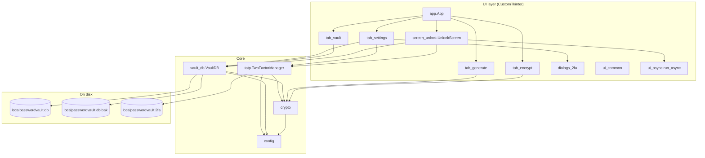
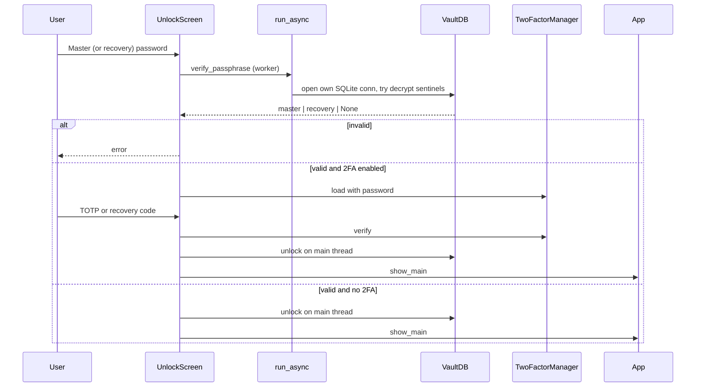

# LocalPasswordVault Architecture

This document describes how LocalPasswordVault is structured, how secrets are protected, and what to change before scaling distribution (Git + binaries).

**Disclaimer:** LocalPasswordVault is provided **AS IS** for personal/experimental use. See [README.md](README.md#disclaimer--use-as-is) and [LICENSE](LICENSE). Not a substitute for an audited commercial password manager.

---

## 1. Goals

| Goal | Approach |
|------|----------|
| Offline-first password vault | Local SQLite + desktop UI |
| Strong at-rest crypto | Random DEK + Argon2id wraps + AES-256-GCM fields |
| Second factor without a cloud IdP | App-level TOTP file encrypted with master password |
| Recoverability | Recovery unwraps DEK, then forces new master; recovery codes; `.bak`; export |
| Cross-platform UI | CustomTkinter on Windows / macOS / Linux |

---

## 2. High-level layout

The repo is a **flat Python package** (modules live at the project root, not under `LocalPasswordVault/`).

```
LocalPasswordVault/                 ← repository root
├── app.py                   ← CTk root window, nav, tab host, main()
├── __main__.py              ← python __main__.py → app.main()
├── __init__.py              ← package docstring + App export
├── config.py                ← paths, Argon2 params, colors, fonts, UI_SCALE
├── crypto.py                ← encrypt/decrypt, strength, password gen
├── vault_db.py              ← SQLite VaultDB singleton
├── totp.py                  ← RFC 6238 TOTP + TwoFactorManager
├── ui_async.py              ← background work helper
├── ui_common.py             ← shared widgets (EWP, QR, buttons, tabs)
├── screen_unlock.py         ← create / unlock / 2FA / corrupt recovery
├── tab_vault.py             ← credential list + entry dialog
├── tab_encrypt.py           ← standalone text/file crypto
├── tab_generate.py          ← generator UI
├── tab_settings.py          ← master/recovery/export/2FA
├── dialogs_2fa.py           ← 2FA setup / transfer / codes / disable
├── pyproject.toml           ← package metadata + console script
├── requirements.txt         ← pip install -r
├── localpasswordvault.spec         ← PyInstaller one-file build
├── README.md
└── architecture.md          ← this file
```

### Runtime data (created at first use)

Written beside the app (`config._app_dir()`):

```
localpasswordvault.db          vault + meta sentinels
localpasswordvault.db.bak      last good copy of the vault
localpasswordvault.2fa         encrypted TOTP secret + recovery hashes
```

Frozen builds (`sys.frozen`) use the **executable’s directory**; source runs use the **directory containing `config.py`**.

---

## 3. Component diagram



---

## 4. Security model

### 4.1 Three-asset model

With 2FA enabled, opening the vault requires **all** of:

1. `localpasswordvault.db`  
2. `localpasswordvault.2fa`  
3. Master password  

Plus a current TOTP (or a one-time recovery code).

Without 2FA, requirements shrink to the database + master (or recovery) passphrase.

### 4.2 Cryptography

| Piece | Detail |
|-------|--------|
| KDF | Argon2id — `iterations=3`, `memory=65536` KiB (64 MiB), `lanes=4`, `key_len=32` |
| AEAD | AES-256-GCM — random 16-byte salt + 12-byte nonce per ciphertext |
| Wire format | JSON blob (v, kdf, alg, params, s, n, c) → Base64 token |
| DEK | Random URL-safe key; fields encrypted with DEK |
| Master wrap | `dek_wrap_master` = encrypt(DEK, master); `master_check` sentinel |
| Recovery wrap | Optional `dek_wrap_recovery` + `recovery_check` (no `__NO_RECOVERY__`) |
| Field encryption | `entries.enc_password`, `entries.enc_totp` encrypted with DEK |
| 2FA file | Entire JSON payload encrypted with master via same helpers |
| Recovery codes | SHA-256 of normalized code; only hashes stored; HMAC compare |
| Post-recovery | Unlock with recovery → must set new master before vault UI |

`crypto._encrypt` / `_decrypt` are the single crypto surface used by vault fields, export envelopes, standalone Encrypt tab, and the `.2fa` file.

### 4.3 Unlock sequence



Design notes:

- Argon2 verification runs **off the Tk thread** so the UI stays responsive.  
- `verify_passphrase` does **not** leave the vault unlocked; `unlock()` runs on the main thread after success.  
- Incomplete 2FA setup never commits `localpasswordvault.2fa` until the wizard finishes (`begin_setup` → `commit_setup`).

### 4.4 What is (and is not) protected

| Protected | Not a security boundary |
|-----------|-------------------------|
| Password fields at rest | Title, username, URL, notes (plaintext in SQLite today) |
| Entry TOTP secrets at rest | Process memory while unlocked (master held in RAM) |
| App TOTP secret on disk | Screen / shoulder surfing; no idle auto-lock yet |
| Export file (separate passphrase) | Clipboard persistence (no auto-clear yet) |

### 4.5 Backup & export

| Mechanism | Behavior |
|-----------|----------|
| `.bak` | File copy of DB after mutations; same encryption / same password |
| Encrypted JSON export | All entries re-wrapped with a user-chosen export passphrase |
| Corrupt / empty DB | Unlock UI offers restore-from-backup or reset |

---

## 5. Module responsibilities

| Module | Responsibility |
|--------|----------------|
| `config` | Platform fonts, palette, `UI_SCALE` / `pad()`, vault paths, Argon2 constants |
| `crypto` | KDF + AEAD, strength scoring, `gen_password` |
| `vault_db` | Schema, CRUD, master rotation (re-encrypt fields), import/export, backup |
| `totp` | Pure-stdlib TOTP; recovery code gen/hash; `.2fa` lifecycle |
| `ui_async` | `run_async` / `is_busy` — daemon thread + `widget.after` marshal |
| `ui_common` | Shared CTk/Tk widgets, QR matrix canvas, strength bar, tab styling |
| `screen_unlock` | First-run create, unlock steps, corrupt vault recovery |
| `tab_*` | Feature screens |
| `dialogs_2fa` | Modal 2FA flows |
| `app` | Shell: lock button, tabview, platform DPI tweaks |

Singletons: `vault_db.vault`, `totp.tfa`.

---

## 6. SQLite schema

```sql
meta (
  key   TEXT PRIMARY KEY,
  value TEXT NOT NULL
  -- master_check, recovery_check, …
)

entries (
  id            TEXT PRIMARY KEY,
  title         TEXT NOT NULL,
  username      TEXT NOT NULL DEFAULT '',
  enc_password  TEXT NOT NULL,
  url           TEXT NOT NULL DEFAULT '',
  notes         TEXT NOT NULL DEFAULT '',
  created       INTEGER NOT NULL,
  enc_totp      TEXT NOT NULL DEFAULT ''
)
```

WAL mode is enabled (`PRAGMA journal_mode=WAL`). Migrations are additive (`enc_totp` column).

---

## 7. Packaging & distribution architecture

### 7.1 Source distribution (Git)

```
clone → (optional venv) → pip install -r requirements.txt → python app.py
```

This is the primary cross-platform distribution path. See `README.md`.

### 7.2 Installed package

`pyproject.toml` defines:

- `requires-python = ">=3.11"`  
- dependencies: `cryptography`, `customtkinter`, `qrcode`  
- script: `LocalPasswordVault = "app:main"`  
- Hatch wheel with `packages = ["."]` (flat layout)

Caveat: flat top-level modules (`config`, `app`, …) can collide with other packages if installed into a shared environment. Prefer a **venv**, or later nest code under a real `localpasswordvault/` package and switch imports to `localpasswordvault.*`.

### 7.3 Frozen binary (PyInstaller)

`localpasswordvault.spec` builds a **windowed one-file** binary from `app.py`.

| Concern | Behavior |
|---------|----------|
| Entry | `app:main` via Analysis of `app.py` |
| Paths | `_app_dir()` uses `sys.executable` when frozen |
| Hidden imports | `customtkinter`, `qrcode`, Argon2/AESGCM modules |
| Console | Off (`console=False`) |

Build **on each target OS**. Do not expect a Windows exe to run on macOS or vice versa.

### 7.4 Git-hosting readiness (engineering checklist)

| Item | Status / action |
|------|-----------------|
| `.gitignore` excludes vaults, venv, `dist/`, `build/` | Required |
| `requirements.txt` includes `customtkinter` | Required (aligned with `pyproject.toml`) |
| No real secrets in history | Scan before public push |
| `LICENSE` | MIT present |
| CI (optional) | `pytest` / ruff on push; matrix Win + macOS |
| Release artifacts (optional) | GitHub Actions + PyInstaller per OS |
| Package rename (future) | Move to `LocalPasswordVault/` package to fix `python -m LocalPasswordVault` cleanly |

---

## 8. Threading model

```
Main / Tk thread          Worker thread
─────────────────         ─────────────
UI events                 Argon2 verify
run_async(...)  ────────► encrypt/decrypt large payloads
                          export / import / file crypto
widget.after(0, cb) ◄──── result or exception
```

Rules of thumb already encoded in the app:

- Do not touch Tk widgets from the worker.  
- Do not call `vault.unlock()` from the worker; verify first, unlock on main.  
- `is_busy` prevents double-submits on the same widget.

---

## 9. Known limitations (architecture debt)

1. **Flat import layout** — works with `python app.py`; package/`-m` story is awkward.  
2. **Metadata plaintext** — titles/usernames/URLs/notes are not field-encrypted.  
3. **Master in RAM** — standard for desktop vaults; OS memory attacks are out of scope.  
4. **One-file PyInstaller** — larger binary, slower cold start; antivirus false positives possible.  
5. **UI mix** — remaining tk/ttk widgets beside CustomTkinter; light mode only.

---

## 10. Suggested next steps for distribution maturity

1. Nest modules under `LocalPasswordVault/` and fix relative imports → reliable `python -m LocalPasswordVault`.  
2. GitHub Actions: lint + `pytest` on push.  
3. Optional release workflow: build `localpasswordvault.spec` on `windows-latest` and `macos-latest`, upload artifacts.  
4. Encrypt or blind additional SQLite columns if threat model requires hiding metadata.  
5. Reduce remaining tk/CTk mix; optional dark mode.

---

## 11. Version

Aligned with `pyproject.toml`: **LocalPasswordVault 4.0.0**.
