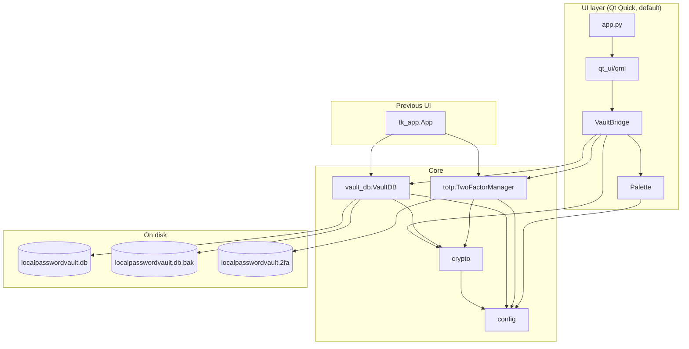
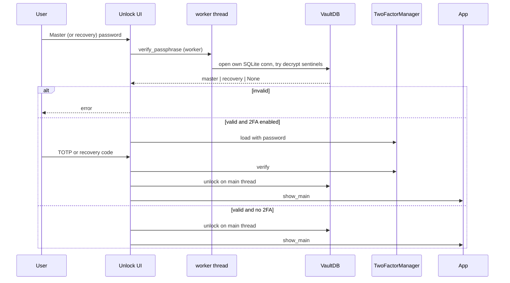

# LocalPasswordVault Architecture

This document describes how LocalPasswordVault is structured, how secrets are protected, and what to change before scaling distribution (Git + binaries).

**Disclaimer:** LocalPasswordVault is provided **AS IS** for personal/experimental use. See [README.md](README.md#disclaimer--use-as-is) and [LICENSE](LICENSE). Not a substitute for an audited commercial password manager.

## Current state

Read this before changing the app.

- The running UI is PySide6 Qt Quick: sidebar (Vault, Encrypt, Generate, Settings), navy `#1E3A5F` and emerald `#059669`, light/dark theme, focus rings, Windows 11 caption color. Entry point is `python app.py`. The process is a `QGuiApplication`. The previous CustomTkinter window is `python tk_app.py`.
- Quit calls `release_qml()` so the QML windows are destroyed while `lpv` and `bridge` still exist. Parenting the engine last does not by itself stop the shutdown `TypeError` spam.
- The Python core is the source of truth and must keep opening existing vault files: `crypto.py`, `vault_db.py`, `totp.py`. Field tokens are v4 AES-GCM under the DEK (Argon2id only for passphrases). Titles, usernames, URLs, notes, passwords, and TOTP secrets are encrypted. Legacy v3 and plaintext-metadata vaults upgrade on unlock. Backups use the SQLite backup API.
- Tests in `tests/test_crypto_vault.py` cover that format. Do not change the on-disk format.
- QML calls the existing vault, crypto, and 2FA functions through `qt_ui/bridge.py`. Argon2 stays off the UI thread (`begin_unlock` on a worker, `finish_unlock` on the GUI thread).
- Do not port the vault logic to C# or Swift.
- Handoff notes for the next session are in [context.md](context.md).

---

## 1. Goals

| Goal | Approach |
|------|----------|
| Offline-first password vault | Local SQLite + desktop UI |
| Strong at-rest crypto | Random DEK + Argon2id wraps + AES-256-GCM fields |
| Second factor without a cloud IdP | App-level TOTP file encrypted with master password |
| Recoverability | Recovery unwraps DEK, then forces new master; recovery codes; `.bak`; export |
| Cross-platform UI | PySide6 Qt Quick on Windows / macOS / Linux. CustomTkinter remains as `tk_app.py` |

---

## 2. High-level layout

The repo is a **flat Python package** (modules live at the project root, not under `LocalPasswordVault/`).

```
LocalPasswordVault/                 ← repository root
├── app.py                   ← Qt entry (`python app.py`)
├── tk_app.py                ← previous CustomTkinter window
├── qt_ui/                   ← QML screens and VaultBridge
├── __main__.py              ← python __main__.py → app.main()
├── __init__.py              ← package docstring + App export
├── config.py                ← paths, Argon2 params, colors, fonts, UI_SCALE
├── crypto.py                ← encrypt/decrypt, strength, password gen
├── vault_db.py              ← SQLite VaultDB singleton
├── totp.py                  ← RFC 6238 TOTP + TwoFactorManager
├── ui_async.py              ← background work helper
├── ui_common.py             ← shared widgets (EWP, QR, buttons, tabs)
├── screen_unlock.py         ← create / unlock / 2FA / corrupt recovery
├── tab_vault.py             ← credential list + entry dialog
├── tab_encrypt.py           ← standalone text/file crypto
├── tab_generate.py          ← generator UI
├── tab_settings.py          ← master/recovery/export/2FA
├── dialogs_2fa.py           ← 2FA setup / transfer / codes / disable
├── pyproject.toml           ← package metadata + console script
├── requirements.txt         ← pip install -r
├── localpasswordvault.spec  ← PyInstaller folder build
├── packaging/hooks/         ← Qt QML plugin filter for that build
├── wordlist.txt             ← passphrase generator word list
├── README.md
├── architecture.md          ← this file
└── context.md               ← session handoff for the next change
```

### Runtime data (created at first use)

Written beside the app (`config._app_dir()`):

```
localpasswordvault.db          vault + meta sentinels
localpasswordvault.db.bak      last good copy of the vault
localpasswordvault.2fa         encrypted TOTP secret + recovery hashes
```

Frozen builds (`sys.frozen`) use the **executable’s directory**; source runs use the **directory containing `config.py`**.

---

## 3. Component diagram



---

## 4. Security model

### 4.1 Three-asset model

With 2FA enabled, opening the vault requires **all** of:

1. `localpasswordvault.db`  
2. `localpasswordvault.2fa`  
3. Master password  

Plus a current TOTP (or a one-time recovery code).

Without 2FA, requirements shrink to the database + master (or recovery) passphrase.

### 4.2 Cryptography

| Piece | Detail |
|-------|--------|
| KDF | Argon2id — `iterations=3`, `memory=65536` KiB (64 MiB), `lanes=4`, `key_len=32` |
| AEAD | AES-256-GCM. Passphrase tokens add a random 16-byte salt. Field tokens use a 12-byte nonce only. |
| Passphrase token | JSON blob v3 (kdf, params, s, n, c) → Base64. Used for wraps, export, 2FA, and text encrypt. |
| Field token | JSON blob v4 (n, c) → Base64. AES-GCM under the DEK, no Argon2. |
| File envelope | `LPVF` magic, one Argon2id header, then 1 MiB authenticated chunks. |
| DEK | Random URL-safe key; SHA-256 of that key is the AES-256 field key |
| Master wrap | `dek_wrap_master` = Argon2id encrypt(DEK, master); `master_check` sentinel |
| Recovery wrap | Optional `dek_wrap_recovery` + `recovery_check` (no `__NO_RECOVERY__`) |
| Field encryption | v4 AES-GCM tokens for title, username, password, URL, notes, and TOTP. The column name is authenticated so ciphertext cannot be swapped between columns. Legacy v3 tokens are upgraded on unlock. |
| 2FA file | Entire JSON payload encrypted with master via same helpers |
| Recovery codes | SHA-256 of normalized code; only hashes stored; HMAC compare |
| Post-recovery | Unlock with recovery → must set new master before vault UI |

`crypto._encrypt` / `_decrypt` wrap passphrases (master, recovery, export, text encrypt, `.2fa`). `encrypt_field` / `decrypt_field` protect vault columns. `encrypt_file` / `decrypt_file` protect arbitrary files.

### 4.3 Unlock sequence



Design notes:

- Argon2 verification runs **off the GUI thread** (`begin_unlock` on a `QThread` in Qt, `run_async` in Tk).  
- `begin_unlock` does **not** leave the vault unlocked. `finish_unlock()` runs on the GUI thread after success.  
- Incomplete 2FA setup never commits `localpasswordvault.2fa` until the wizard finishes (`begin_setup` → `commit_setup`).

### 4.4 What is (and is not) protected

| Protected | Not a security boundary |
|-----------|-------------------------|
| Title, username, URL, notes, password, and entry TOTP at rest | Process memory while unlocked (master and DEK held in RAM) |
| App TOTP secret on disk | Screen / shoulder surfing while the vault is open |
| Export file (separate passphrase) | A copied secret remains on the clipboard until the 30s timer or lock, and only if nothing else replaced it |
| Consistent `.db.bak` snapshot | Someone who already has the unlocked process |

### 4.5 Backup & export

| Mechanism | Behavior |
|-----------|----------|
| `.bak` | SQLite backup API snapshot after mutations, then WAL checkpoint. Restore deletes `-wal` / `-shm` so an old journal cannot replay over the backup |
| Encrypted JSON export | All entries re-wrapped with a user-chosen export passphrase |
| Corrupt / empty DB | Unlock UI offers restore-from-backup or reset |

---

## 5. Module responsibilities

| Module | Responsibility |
|--------|----------------|
| `config` | Platform fonts, palette, `UI_SCALE` / `pad()`, vault paths, Argon2 constants. CustomTkinter is imported only inside the Tk helpers |
| `crypto` | KDF + AEAD, strength scoring, `gen_password` |
| `vault_db` | Schema, CRUD, master rotation (re-encrypt fields), import/export, backup |
| `totp` | Pure-stdlib TOTP; recovery code gen/hash; `.2fa` lifecycle |
| `app` | Qt launcher. `main()` calls `qt_ui.main` |
| `tk_app` | Previous CustomTkinter shell. `python tk_app.py` |
| `qt_ui.main` | `QGuiApplication`, QML engine, Windows caption color. `release_qml()` deletes the windows before the engine clears `lpv` and `bridge` |
| `qt_ui.bridge` | `VaultBridge` slots and signals. The only QML-facing object for vault work |
| `qt_ui.palette` | Navy and emerald tokens from `config.C`, plus system font names |
| `qt_ui/qml` | Screens and controls. Do not put `Repeater` delegates inside a `ColumnLayout` |
| `ui_async` | Tk only. `run_async` / `is_busy` |
| `ui_common` | Tk widgets, QR canvas, strength bar |
| `screen_unlock`, `tab_*`, `dialogs_2fa` | Tk screens. Qt reimplements the same behavior in QML |

Singletons: `vault_db.vault`, `totp.tfa`.

---

## 6. SQLite schema

```sql
meta (
  key   TEXT PRIMARY KEY,
  value TEXT NOT NULL
  -- master_check, recovery_check, dek_wrap_*, idle_lock_minutes, …
)

entries (
  id            TEXT PRIMARY KEY,
  enc_title     TEXT NOT NULL,
  enc_username  TEXT NOT NULL,
  enc_password  TEXT NOT NULL,
  enc_url       TEXT NOT NULL,
  enc_notes     TEXT NOT NULL,
  enc_totp      TEXT NOT NULL DEFAULT '',
  created       INTEGER NOT NULL,
  updated       INTEGER NOT NULL
)
```

WAL mode is enabled (`PRAGMA journal_mode=WAL`). `secure_delete` is on. Older databases that stored metadata in plaintext, or encrypted fields with per-field Argon2 (v3), are rewritten to this schema on the next successful unlock. The plaintext pages are dropped and the file is vacuumed.

---

## 7. Packaging & distribution architecture

### 7.1 Source distribution (Git)

```
clone → (optional venv) → pip install -r requirements.txt → python app.py
```

This is the primary cross-platform distribution path. See `README.md`.

### 7.2 Installed package

`pyproject.toml` defines:

- `requires-python = ">=3.11"`  
- dependencies: `cryptography`, `PySide6`, `customtkinter`, `qrcode`  
- script: `LocalPasswordVault = "app:main"`  
- Hatch wheel with `packages = ["."]` (flat layout)

Caveat: flat top-level modules (`config`, `app`, …) can collide with other packages if installed into a shared environment. Prefer a **venv**, or later nest code under a real `localpasswordvault/` package and switch imports to `localpasswordvault.*`.

### 7.3 Frozen binary (PyInstaller)

Two frozen folders. Both commands use `--user` and no virtual environment. Build on the target OS. Zip each output directory. The executable needs the libraries beside it. Do not run both builds on the same vault at once.

**Qt (current).** `localpasswordvault.spec` builds `dist/LocalPasswordVault/` from `app.py`. One-file mode unpacks on every launch. An earlier one-file build was about 280 MB because `collect_all("PySide6")` included the web engine. The folder is about **110 MB** on Windows and was launched there. A macOS Qt build has not been run.

**CustomTkinter (previous).** Do not point the Qt spec at `tk_app.py`. Build `tk_app.py` with `--windowed --name LocalPasswordVaultTk`, `--collect-data customtkinter`, and `--add-data` for `wordlist.txt` (`;` on Windows, `:` on macOS). Output is `dist/LocalPasswordVaultTk/`. That frozen build has not been run. Commands are in [README.md](README.md#build-distributable-binaries).

Qt spec only:

| Concern | Behavior |
|---------|----------|
| Entry | `app:main` via Analysis of `app.py` |
| Paths | `_app_dir()` uses `sys.executable` when frozen. Vault files appear beside the exe, not inside `_internal` |
| Qt | Qt Quick, Basic controls, layouts, file dialogs. `packaging/hooks/hook-PySide6.QtQml.py` drops the other QML plugins |
| Left out | WebEngine, 3D, multimedia, PDF, CustomTkinter, `opengl32sw.dll` |
| App QML | `qt_ui/qml` and `wordlist.txt` are copied into the bundle |
| Console | Off (`console=False`) |

Build **on each target OS**. Do not expect a Windows exe to run on macOS or vice versa.

### 7.4 Git-hosting readiness (engineering checklist)

| Item | Status / action |
|------|-----------------|
| `.gitignore` excludes vaults, venv, `dist/`, `build/` | Required |
| `requirements.txt` includes `PySide6` and `customtkinter` | Required (aligned with `pyproject.toml`) |
| No real secrets in history | Scan before public push |
| `LICENSE` | MIT present |
| CI (optional) | `pytest` / ruff on push; matrix Win + macOS |
| Release artifacts (optional) | GitHub Actions + PyInstaller per OS |
| Package rename (future) | Move to `LocalPasswordVault/` package to fix `python -m LocalPasswordVault` cleanly |

---

## 8. Threading model

```
GUI thread                     Worker QThread
──────────                     ──────────────
QML and VaultBridge slots      begin_unlock, create
finish_unlock()                master / recovery change
entry CRUD (AES-GCM)           export, import
clipboard and idle timer       text encrypt, file encrypt
```

The Tk window still uses `ui_async.run_async` and `widget.after`.

Rules:

- Do not touch QML or Tk from the worker. Return plain values and finish on the GUI thread.
- Do not call `finish_unlock()` or `vault.unlock()` on the worker. `begin_unlock` only stashes the DEK.
- `VaultBridge.busy` ignores a second heavy call.
- Passphrases are slot arguments. Do not put them in a QML URL or a log line.

---

## 9. Known limitations (architecture debt)

1. **Flat import layout** — works with `python app.py`; package/`-m` story is awkward.  
2. **Master and DEK in RAM** — standard for desktop vaults; OS memory attacks are out of scope.  
3. **Recovery passphrase skips app 2FA** — by design, then the user must set a new master before the vault opens.  
4. **Folder build** — distribute `dist/LocalPasswordVault/`, not a single file. About 110 MB on Windows. `opengl32sw.dll` is omitted, so a machine with no GPU may fail to draw.  
5. **Clipboard clear is best-effort** — the app clears the clipboard on lock only when it still holds the value this process copied.  
6. **Ciphertext length** — field tokens are padded, but they are not a fixed size, so approximate length can still leak.  
7. **Two UIs** — Qt is the default folder `dist/LocalPasswordVault/`. The previous window is a separate folder `dist/LocalPasswordVaultTk/`. README screenshots are still the Tk window.  
8. **Frozen coverage** — the Windows Qt folder launches. macOS Qt, and the Tk folder on either OS, have not been built.

---

## 10. Suggested next steps for distribution maturity

1. Nest modules under `LocalPasswordVault/` and fix relative imports → reliable `python -m LocalPasswordVault`.  
2. GitHub Actions: lint + `pytest` on push.  
3. Optional release workflow: build `localpasswordvault.spec` on `windows-latest` and `macos-latest`, upload artifacts.  
4. Optional: move vault files from the app directory into a user-profile folder, with a one-time migration.  
5. Optional: nest the flat modules under a real package name before a shared-environment install.

---

## 11. Version

Aligned with `pyproject.toml`: **LocalPasswordVault 4.0.0**.
